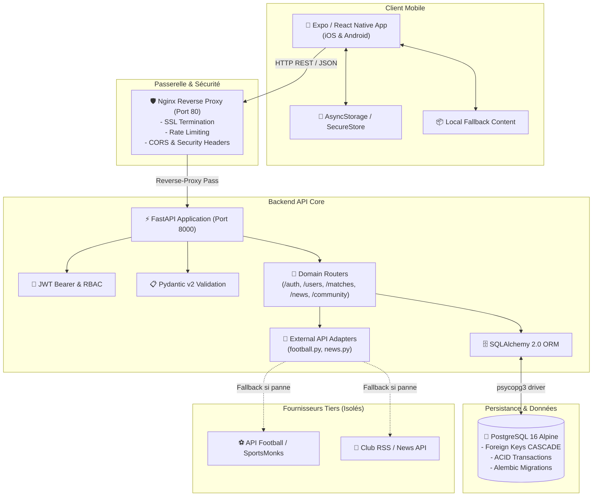
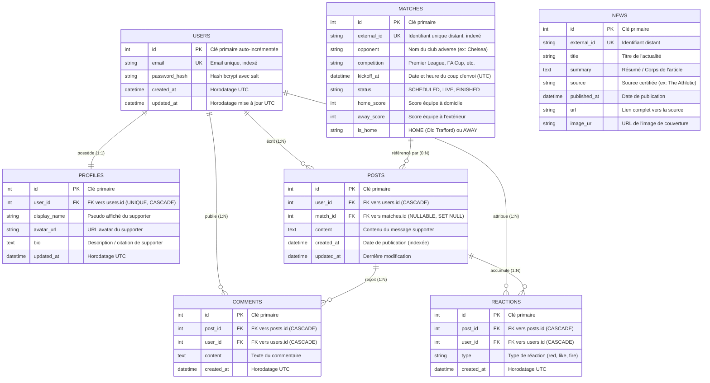

# 🔴 THE RED — Manchester United Fan App (MVP)

[](https://www.python.org/)
[](https://fastapi.tiangolo.com/)
[](https://www.postgresql.org/)
[](https://expo.dev/)
[](https://www.docker.com/)
[](https://pytest.org/)
[](LICENSE)

> **Application mobile et plateforme communautaire dédiée aux supporters inconditionnels de Manchester United ("Red Devils").**  
> Projet individuel d'ingénierie logicielle (Trimestre 3 - Holberton School) réalisé par **Harold Nguemeta**.

---

## 📖 Sommaire
1. [Vision & Piliers du MVP](#-vision--piliers-du-mvp)
2. [Architecture Applicative](#-architecture-applicative)
3. [Schéma de la Base de Données](#-schéma-de-la-base-de-données)
4. [Sécurité & Authentification](#-sécurité--authentification)
5. [Stack Technique](#-stack-technique)
6. [Arborescence du Projet](#-arborescence-du-projet)
7. [Installation & Démarrage Rapide](#-installation--démarrage-rapide)
8. [Documentation de l'API REST](#-documentation-de-lapi-rest)
9. [Stratégie de Test & Qualité](#-stratégie-de-test--qualité)
10. [Méthodologie Agile & Sprints](#-méthodologie-agile--sprints)

---

## 🎯 Vision & Piliers du MVP

L'application résout la fragmentation de l'information pour les fans de Manchester United en réunissant au même endroit l'actualité certifiée, le suivi des matchs et un espace d'expression communautaire.

L'application repose sur **3 piliers fondamentaux** :
- ⚽ **Pilier 1 : Match Center** — Calendrier complet des rencontres des Red Devils (Premier League, coupes nationales, compétitions européennes), résultats en temps réel, scores, et détails des matchs (domicile/extérieur, Old Trafford).
- 📰 **Pilier 2 : United News** — Agrégation d'actualités certifiées du club, filtre chronologique et lecteur d'articles sans distraction avec mode de lecture hors-ligne.
- 🗣️ **Pilier 3 : Fan Community** — Espace d'échange entre passionnés avec publication de posts (possibilité d'associer un match spécifique), commentaires et réactions dédiées (*Red*, *Fire*, *Like*).

> **Règle d'or ergonomique** : N'importe quelle fonctionnalité clé de l'application est accessible en **3 clics/taps maximum** depuis l'écran d'accueil.

---

## 🏗️ Architecture Applicative

L'application adopte une architecture **3-tiers découplée** assurant la séparation des responsabilités, la résilience et l'isolation des API tierces.



### Principes d'ingénierie clés :
1. **Isolation stricte des API tierces** : Le client mobile ne contacte **jamais** directement les API externes. Tout transite par les adaptateurs backend (`football.py`, `news.py`) qui normalisent les formats et disposent de bouchons locaux en cas d'indisponibilité.
2. **Offline-First & Graceful Degradation** : Le client mobile intègre un service de secours (`theRedApiClient.ts`) capable de restituer un contenu cohérent même sans réseau.
3. **Stateless Backend** : Pas d'état de session conservé en mémoire vive sur le serveur ; chaque requête authentifiée transporte son jeton JWT dans l'en-tête `Authorization: Bearer <token>`.

---

## 🗄️ Schéma de la Base de Données

Le schéma relationnel est modélisé sous PostgreSQL 16 et géré via l'ORM SQLAlchemy 2.0 avec des migrations de schéma automatisées par Alembic.



### Relations & Contraintes d'Intégrité :
- **Relation 1-à-1 `users` $\leftrightarrow$ `profiles`** : Séparation stricte des données sensibles de connexion (`password_hash`) et des données de profil public.
- **Relation 1-à-N `users` $\rightarrow$ `posts`** et **`posts` $\rightarrow$ `comments`** : Avec politique `ON DELETE CASCADE` pour supprimer les données enfants en cas de suppression du compte ou du post.
- **Relation N-à-N matérialisée `reactions`** : Table de jointure enrichie associant un utilisateur, un post et un type de réaction (`red`, `like`, `fire`).
- **Indexation stratégique** : Index B-Tree sur les champs souvent interrogés (`email`, `kickoff_at`, `created_at`, `status`).

---

## 🔒 Sécurité & Authentification

- **Hachage à sens unique (`bcrypt`)** : Les mots de passe sont hachés avec un sel aléatoire cryptographique avant insertion en base de données.
- **Tokens JWT Bearer** : Signature `HMAC-SHA256` (`HS256`) avec délai d'expiration configurable.
- **Protection contre les injections SQL** : Utilisation exclusive du Query Builder et du mapper de SQLAlchemy 2.0 avec requêtes préparées paramétrées.
- **Validation Pydantic** : Rejet automatique des payloads mal formés avec messages HTTP 422 standardisés.
- **Reverse-Proxy Nginx** : Masquage des en-têtes internes du serveur, prévention du MIME sniffing (`X-Content-Type-Options: nosniff`), blocage de l'iframe embedding (`X-Frame-Options: DENY`) et protection XSS.

---

## 💻 Stack Technique

| Périmètre | Technologie | Rôle & Justification |
|---|---|---|
| **Mobile Frontend** | **Expo / React Native (TypeScript)** | Application native multiplateforme (iOS & Android) |
| **Backend API** | **FastAPI (Python 3.10+)** | Framework REST asynchrone à haute performance |
| **Validation & Typage** | **Pydantic v2** | Sérialisation et validation stricte des données |
| **Base de Données** | **PostgreSQL 16 Alpine** | SGBDR relationnel robuste, ACID et scalable |
| **ORM & Migrations** | **SQLAlchemy 2.0 + Alembic** | Modélisation objet-relationnelle et migrations versionnées |
| **Sécurité** | **bcrypt + PyJWT** | Hachage sécurisé et jetons d'accès Bearer |
| **Reverse Proxy** | **Nginx Alpine** | Passerelle HTTP, routage, headers de sécurité |
| **Conteneurisation** | **Docker & Docker Compose** | Environnement d'exécution unifié et reproductible |
| **Tests** | **Pytest + TestClient (httpx)** | Tests unitaires et d'intégration automatisés |

---

## 📂 Arborescence du Projet

```text
THE-RED/
├── .gitignore                      # Règles d'exclusion Git (node_modules, venv, secrets)
├── docker-compose.yml              # Orchestration multi-conteneurs (Postgres, API, Nginx)
├── README.md                       # Documentation officielle et guide de soutenance
├── THE_RED_STAGE_4_PLAN.md         # Plan d'implémentation et d'exécution détaillé
├── nginx/
│   └── nginx.conf                  # Configuration du reverse-proxy Nginx
├── backend/                        # Backend API FastAPI
│   ├── Dockerfile                  # Image Docker multi-stage pour le backend
│   ├── requirements.txt            # Dépendances Python
│   ├── alembic.ini                 # Configuration des migrations Alembic
│   ├── alembic/                    # Scripts de migration de la base
│   ├── app/
│   │   ├── main.py                 # Point d'entrée de l'application FastAPI
│   │   ├── core/                   # Configuration, DB, Sécurité, Dépendances
│   │   ├── models/                 # Modèles relationnels SQLAlchemy 2.0
│   │   ├── schemas/                # Schémas de validation Pydantic v2
│   │   ├── routers/                # Contrôleurs REST (/auth, /users, /matches, /news, /community)
│   │   └── integrations/           # Adaptateurs API Football & News (avec mode mock)
│   └── tests/
│       ├── conftest.py             # Fixtures Pytest & DB in-memory
│       └── test_api.py             # Suite de tests d'intégration (5/5 passés)
└── app/                            # Application Mobile Expo / React Native
    ├── App.tsx                     # Racine de l'application mobile
    ├── app.json                    # Configuration du projet Expo (THE RED, com.thered.app)
    ├── package.json                # Dépendances npm du client mobile
    └── src/
        ├── screens/the-red/        # Écrans clés (MatchCenter, News, Community)
        ├── services/               # Client API (TheRedApi) et gestionnaires de données
        ├── navigation/             # Navigation par onglets (respect de la règle des 3 taps)
        └── constants/              # Charte graphique Manchester United (Rouge, Noir, Or)
```

---

## 🚀 Installation & Démarrage Rapide

### Option A : Déploiement complet avec Docker Compose (Recommandé)

1. **Cloner le dépôt** :
   ```bash
   git clone https://github.com/haroldjunior501-cell/the-red.git
   cd the-red
   ```

2. **Démarrer l'infrastructure complète** :
   ```bash
   docker compose up --build -d
   ```
   * PostgreSQL démarre sur le port `5432`.
   * L'API FastAPI démarre sur `http://localhost:8000`.
   * Nginx reverse-proxy écoute sur `http://localhost:80`.

3. **Vérifier l'état de santé de l'API** :
   ```bash
   curl http://localhost/health
   # Réponse : {"status":"healthy","project":"THE RED","club":"Manchester United","version":"1.0.0"}
   ```

---

### Option B : Lancement en Développement Local

#### 1. Backend FastAPI
```bash
cd backend
python -m venv .venv
# Sous Windows :
.venv\Scripts\activate
# Sous Linux/macOS :
# source .venv/bin/activate

pip install -r requirements.txt
uvicorn app.main:app --reload --port 8000
```
* Swagger UI : [http://localhost:8000/docs](http://localhost:8000/docs)
* Redoc UI : [http://localhost:8000/redoc](http://localhost:8000/redoc)

#### 2. Frontend Mobile Expo
Dans un second terminal :
```bash
cd app
npm install
npm run start
```
* Scannez le QR code affiché dans le terminal avec l'application **Expo Go** (Android / iOS) ou appuyez sur `w` pour lancer la version Web.

---

## 📡 Documentation de l'API REST

| Méthode | Endpoint | Authentifié | Description |
|---|---|:---:|---|
| `GET` | `/health` | Non | Santé du système et métadonnées du club |
| `POST` | `/api/v1/auth/register` | Non | Inscription d'un nouveau supporter Red Devil |
| `POST` | `/api/v1/auth/login` | Non | Connexion et délivrance du jeton Bearer JWT |
| `GET` | `/api/v1/users/me` | **Oui** | Consultation du profil de l'utilisateur connecté |
| `PATCH` | `/api/v1/users/me` | **Oui** | Mise à jour du profil (pseudo, bio, avatar) |
| `GET` | `/api/v1/matches` | Non | Liste des rencontres (calendrier & résultats) |
| `GET` | `/api/v1/matches/{id}` | Non | Détail tactique d'un match de Manchester United |
| `GET` | `/api/v1/news` | Non | Fil d'actualité certifié Manchester United |
| `GET` | `/api/v1/news/{id}` | Non | Détail complet d'un article |
| `GET` | `/api/v1/community/posts` | Non | Mur de discussion communautaire |
| `POST` | `/api/v1/community/posts` | **Oui** | Publication d'un post supporter |
| `POST` | `/api/v1/community/posts/{id}/comments` | **Oui** | Commentaire sur une publication |
| `POST` | `/api/v1/community/posts/{id}/reactions` | **Oui** | Réaction instantanée (`red`, `like`, `fire`) |

---

## 🧪 Stratégie de Test & Qualité

Pour assurer la stabilité du produit, une suite de tests d'intégration et unitaires est exécutée avec `pytest` :

```bash
cd backend
python -m pytest tests/
```

### Résultats de la suite de tests :
```text
============================= test session starts =============================
platform win32 -- Python 3.14.0, pytest-9.1.1
rootdir: C:\Users\PC\GOALYA\backend
collected 5 items

tests\test_api.py .....                                                  [100%]

======================== 5 passed in 1.54s =========================
```

- **Santé & Disponibilité** : Validation du payload `/api/v1/health`.
- **Flux Utilisateur Complet** : Inscription $\rightarrow$ Récupération du JWT $\rightarrow$ Consultation du profil $\rightarrow$ Modification de profil.
- **Intégrité du Match Center** : Validation du contrat de données Pydantic sur les matchs de Manchester United.

---

## 🗓️ Méthodologie Agile & Sprints

Le développement du projet a été structuré en **6 sprints itératifs** :

| Sprint | Intitulé | Livrables majeurs | Statut |
|---|---|---|:---:|
| **Sprint 0** | Socle & Reproductibilité | Docker Compose, structure projet, Nginx, tests | ✅ Terminé |
| **Sprint 1** | Auth & Données | Modèles User/Profile, JWT, bcrypt, Alembic | ✅ Terminé |
| **Sprint 2** | Match Center | Adaptateur Football, endpoints `/matches` | ✅ Terminé |
| **Sprint 3** | United News | Adaptateur News, flux d'actualités, fallback | ✅ Terminé |
| **Sprint 4** | Fan Community | Modèles Post/Comment/Reaction, endpoints `/community` | ✅ Terminé |
| **Sprint 5** | Frontend Expo | Écrans Home, MatchCenter, News, Community (règle des 3 taps) | ✅ Terminé |
| **Sprint 6** | QA & Soutenance | Validation Pytest 100%, documentation, revue de projet | ✅ Terminé |

---

## 👨‍💻 Auteur

**Harold Nguemeta**  
*Étudiant en Ingénierie Logicielle — Holberton School (Trimestre 3)*  
- GitHub : [@haroldjunior501-cell](https://github.com/haroldjunior501-cell)
