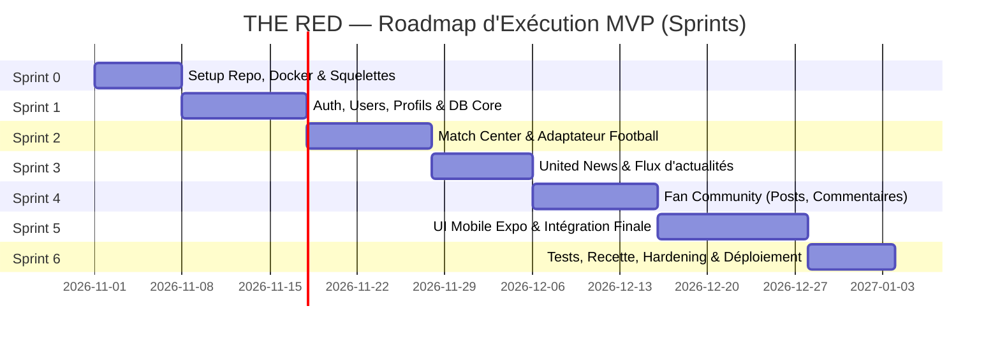
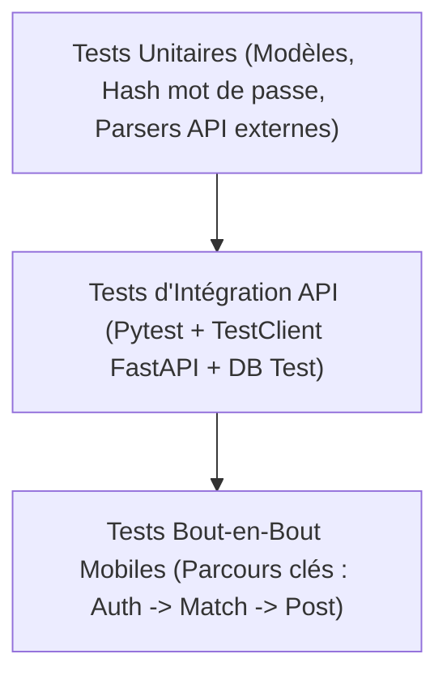

# THE RED — Stage 4 : Plan d'Implémentation et d'Exécution MVP

**Projet** : THE RED (Application mobile dédiée aux supporters de Manchester United)  
**Porteur de projet** : Harold Nguemeta  
**Type de projet** : Projet individuel (Trimestre 3)  
**Piliers du MVP** : Match Center • United News • Fan Community  
**Socle technique cible** : FastAPI • PostgreSQL 16 • SQLAlchemy 2.0 • Alembic • JWT/bcrypt • Docker Compose • Nginx • Expo / React Native  

---

## 1. Rappel des Fondations du Stage 3

Le Stage 3 a établi les choix d'ingénierie et d'architecture :
1. **Séparation claire** : Application mobile Expo/React Native $\rightarrow$ Nginx (reverse-proxy) $\rightarrow$ Backend FastAPI $\rightarrow$ PostgreSQL 16.
2. **Isolation des API tierces** : Le mobile n'appelle jamais directement les API externes (Football & News) ; tout transite par des adaptateurs isolés côté backend avec mode bouchon/fallback.
3. **MoSCoW & Objectifs SMART** :
   - **MUST (US-01 à US-10)** : Auth (register/login/JWT), profil, fixtures & résultats de Manchester United, détails de match, flux d'actualités United et lecture, création et consultation des posts communautaires.
   - **SHOULD (US-11 & US-12)** : Commentaires et réactions sur les posts.
   - **COULD (US-13 & US-14)** : Sondages simples et notifications push.
   - **WON'T (US-15 & US-16)** : Streaming vidéo en direct et IA avancée (Groq/FastMCP reportés en post-MVP).
   - **Règle d'or ergonomique** : Tout pilier fonctionnel doit être accessible en **maximum 3 étapes de navigation** depuis l'écran d'accueil.

---

## 2. Organisation Temporelle : Roadmap des Sprints

Le développement du MVP est structuré en **6 sprints** itératifs (cycle agile adapté au travail individuel) :

### Détail des Sprints

| Sprint | Objectif Principal | Livrables clés |
|---|---|---|
| **Sprint 0** : Initialisation & Socle | Mise en place de l'environnement reproductible | `docker-compose.yml` (PostgreSQL 16 + FastAPI + Nginx), structure projet, configuration linter/test. |
| **Sprint 1** : Authentification & Données | Gestion des utilisateurs et persistance | Modèles SQLAlchemy (`User`, `Profile`), Alembic, endpoints `/auth/register`, `/auth/login`, `/users/me`. |
| **Sprint 2** : Pilier 1 — Match Center | Suivi des rencontres des Red Devils | Adaptateur Football API, endpoints `/matches`, `/matches/{id}`, mise en cache locale. |
| **Sprint 3** : Pilier 2 — United News | Actualités centralisées du club | Adaptateur News (RSS/REST), endpoints `/news`, `/news/{id}`, gestion du fallback hors ligne. |
| **Sprint 4** : Pilier 3 — Fan Community | Espace d'échange entre fans | Modèles `Post`, `Comment`, `Reaction`, endpoints `/community/posts`, modération basique. |
| **Sprint 5** : Frontend Mobile Expo | Interface utilisateur Red & Black | Écrans Home, Match Center, News, Community, Profile ; navigation max 3 taps ; branding MUFC. |
| **Sprint 6** : QA, Sécurité & Déploiement | Validation globale et livraison | Tests Pytest, tests bout-en-bout des flux mobiles, hardening Nginx, playbook Ansible. |

---

## 3. Décomposition des Tâches (WBS — Work Breakdown Structure)

### A. Backend FastAPI & Base de Données
- **T-BE-01** : Initialisation du projet FastAPI sous Python 3.10+, configuration `settings.py` via Pydantic v2.
- **T-BE-02** : Configuration de SQLAlchemy 2.0 avec driver `psycopg3` et pooling de connexions PostgreSQL.
- **T-BE-03** : Mise en place d'Alembic et génération des migrations initiales :
  - Tables : `users`, `profiles`, `matches`, `news`, `posts`, `comments`, `reactions`.
- **T-BE-04** : Module Sécurité : hachage bcrypt, génération et validation des tokens JWT Bearer.
- **T-BE-05** : Routeurs et services `/api/v1/auth` et `/api/v1/users`.
- **T-BE-06** : Adaptateur Football API (`football.py`) : récupération des matchs de Manchester United, normalisation en schéma Pydantic interne, gestion du mode mock.
- **T-BE-07** : Routeurs `/api/v1/matches`.
- **T-BE-08** : Adaptateur News (`news.py`) : agrégation de flux certifiés United, nettoyage HTML, routeur `/api/v1/news`.
- **T-BE-09** : Routeurs et services `/api/v1/community` (CRUD posts, ajout de commentaires, réactions 'like'/'red').

### B. Application Mobile (Expo / React Native)
- **T-MOB-01** : Refonte de la charte graphique : Palette Manchester United (Rouge `#DA291C`, Noir `#000000`, Or/Blanc `#FBE122` / `#FFFFFF`), typographies modernes.
- **T-MOB-02** : Architecture de navigation (React Navigation / Expo Router) avec limitation stricte à **3 clics maximum** pour chaque fonctionnalité.
- **T-MOB-03** : Écran d'accueil (Home) regroupant les 3 piliers :
  - Prochain match de Man United avec compte à rebours.
  - Dernière actualité à la une.
  - Dernier post populaire de la communauté.
- **T-MOB-04** : Écran Match Center : calendrier des rencontres, derniers résultats, onglet détail avec compos et faits marquants.
- **T-MOB-05** : Écran United News : liste des actualités avec filtre et lecteur d'article dédié.
- **T-MOB-06** : Écran Fan Community : fil de discussion, éditeur de nouveau post, vue détaillée du post avec commentaires et réactions instantanées.
- **T-MOB-07** : Écran Profil : visualisation/édition du profil supporter, déconnexion.
- **T-MOB-08** : Client API HTTP (Axios) avec intercepteur JWT (stockage sécurisé `expo-secure-store` et gestion de l'expiration 401).

### C. DevOps, Infrastructure & Scripts
- **T-INF-01** : Dockerfile multi-stage pour le backend FastAPI.
- **T-INF-02** : `docker-compose.yml` avec services `api`, `db` (Postgres 16 Alpine avec healthcheck `pg_isready`), et `reverse-proxy` (Nginx Alpine).
- **T-INF-03** : Configuration Nginx (routage `/api/v1/` vers FastAPI, headers de sécurité, rate limiting).
- **T-INF-04** : Scripts d'exploitation `start_dev.sh` (ou `.ps1` sous Windows) et `stop_dev.sh`.
- **T-INF-05** : Playbook Ansible 2.17 pour provisionner le serveur de test (installation Docker, création des dossiers, déploiement Nginx).

---

## 4. Matrice des Rôles et Responsabilités (RACI)

Dans le cadre d'un projet individuel mené par **Harold Nguemeta**, les différentes casquettes d'ingénierie sont réparties comme suit :

| Domaine d'Activité | Responsable (R) | Approbateur (A) | Consulté (C) | Informé (I) |
|---|---|---|---|---|
| **Architecture & Choix Techniques** | Harold (Lead Dev) | Harold (Product Owner) | Documentation Stage 3 | Équipe Pédagogique |
| **Backend & Base de données** | Harold (Backend) | Harold (PO) | Spécifications OpenAPI | — |
| **Développement Mobile Expo** | Harold (Mobile) | Harold (PO) | Retours Supporters testeurs | — |
| **Assurance Qualité & Tests** | Harold (QA) | Harold (Lead Dev) | Matrice MoSCoW | — |
| **Déploiement & DevOps** | Harold (DevOps) | Harold (Lead Dev) | Playbook Ansible | — |

---

## 5. Stratégie de Test et d'Assurance Qualité (QA)

Pour garantir la robustesse du MVP sans surcharger un développeur solo, une pyramide de tests pragmatique est adoptée :

### Matrice de Couverture des Tests

| Niveau de Test | Outils | Portée | Critère de Succès |
|---|---|---|---|
| **Tests Unitaires** | `pytest` | Hachage bcrypt, tokens JWT, parsing des dates et scores des API externes. | 100% de succès, couverture > 80% sur les helpers. |
| **Tests d'Intégration API** | `pytest`, `httpx` (`TestClient`) | Endpoints `/auth`, `/matches`, `/news`, `/community`. | Réponses conformes aux schémas Pydantic, codes HTTP corrects (200, 201, 401, 404, 422). |
| **Tests de Résilience (Mocks)** | Adaptateurs Python avec fixtures JSON | Coupure de l'API Football ou de la source News. | L'application ne crashe pas, elle sert les données en cache ou le mock avec message propre. |
| **Tests Mobile / UI** | Jest + React Native Testing Library / Tests manuels guidés | Navigation (règle des 3 taps), soumission de post, affichage des matchs. | Aucun blocage d'interface, état d'erreur clair si hors ligne. |
| **Tests de Sécurité** | Scripts de validation | Tentatives d'injection SQL, accès non authentifié aux routes privées, fuite de stack trace. | Aucune trace d'erreur Python ni de variable d'environnement dans les réponses JSON. |

---

## 6. Definition of Done (DoD) pour le MVP

Une tâche ou fonctionnalité n'est considérée comme **terminée** que lorsque l'ensemble des critères suivants est réuni :
- [ ] Le code respecte le contrat d'API documenté au Stage 3.
- [ ] La migration Alembic correspondante a été générée et testée.
- [ ] Les tests Pytest associés passent avec succès.
- [ ] Les erreurs retournent un objet standard `{ "detail": "Message sécurisé" }` sans stack trace.
- [ ] Le flux est vérifié sur simulateur/téléphone mobile en 3 taps maximum.
- [ ] Les conteneurs Docker démarrent sans erreur via `docker compose up --build`.
- [ ] Les modifications sont commitées sur GitHub avec un message clair (`feat:`, `fix:`, `docs:`).

---

## 7. Plan de Transition depuis le Projet Actuel vers THE RED

Pour refondre l'existant en maximisant la réutilisation du code fonctionnel :

1. **Purge du scope hors MVP** :
   - Désactivation des modules Coupe du Monde spécifiques (Tableau 12 groupes, Bracket 72 matchs, Stripe FP packs, Arena simulator).
   - Conservation du moteur de discussion en temps réel et de la gestion de profils.
2. **Re-theming Mobile** :
   - Remplacement des assets Coupe du Monde par l'identité visuelle de **Manchester United** (Old Trafford, maillots rouges, logo du club).
   - Simplification de la barre de navigation : **Accueil**, **Match Center**, **Actualités**, **Communauté**, **Profil**.
3. **Instanciation du Backend FastAPI** :
   - Déploiement du backend Python FastAPI selon l'arborescence recommandée au Stage 3 (`backend/app/`).
   - Configuration de la base de données PostgreSQL 16 Alpine et des adaptateurs d'API Football/News dédiés à United.
